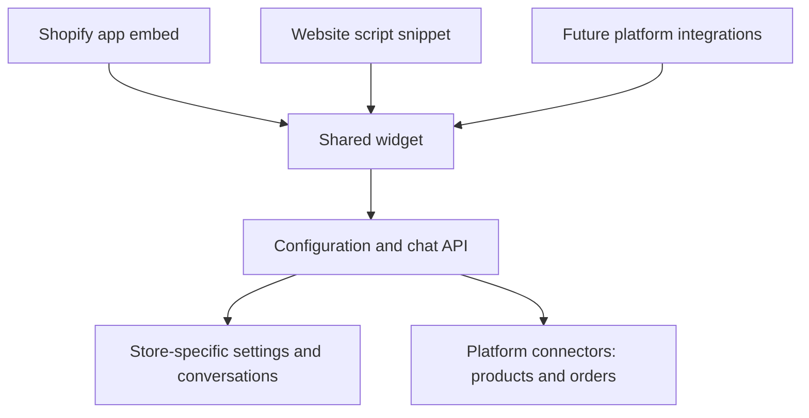

# Multi-platform Chat Widget Plan

Build **one shared widget, with a small integration layer for each platform**. Shopify will be the first integration; the same chat UI, configuration, and messaging code can then serve other websites.

The current widget is a useful starting point: it uses plain JavaScript and CSS, supports remote configuration, and exposes methods such as `init()`, `setFields()`, and `destroy()`.

The shared loader, Shadow DOM, and local design-system work in sections 1 and 2 are implemented. An admin dashboard preview still needs to consume the shared widget bundle when that dashboard is available.

## 1. Make the existing widget the shared core

Keep the core independent of Shopify. It should own the launcher, chat window, messages, product cards, accessibility, and configuration.

The small loader mounts the widget once and loads its assets asynchronously. `npm run release` builds the Vite library and creates versioned local releases so updates can be tested and rolled back by changing the pinned version. Publishing to a CDN requires a release destination.

The widget now uses **Shadow DOM for style isolation**. The `x11-sales-` prefixes remain as an additional boundary.

## 2. Turn the styling into a reusable design system

The widget CSS now applies the design-system skill's three layers:

| Layer | What it contains | Example |
| --- | --- | --- |
| Primitive | Base colors, spacing, typography, radii | Neutral colors, spacing scale |
| Semantic | Purpose of each value | Surface, text, accent, error |
| Component | Values used by individual components | Launcher background, input border |

Tokens are scoped inside the widget. Merchant settings such as `primaryColor` map into semantic tokens, which then feed component tokens. See [DESIGN_SYSTEM.md](DESIGN_SYSTEM.md).

The widget has loading, disabled, error, focus, and hover states. Its layout handles mobile keyboards, narrow screens, safe areas, and reduced motion.

The local demo previews the shared widget and its states. An admin dashboard preview should render the same bundle so it stays accurate; this repository does not contain the admin dashboard.

## 3. Formalize configuration and connect real messaging

Keep the existing `chatDesignFields` format compatible, but add a schema version, validation, defaults, and documented behavior.

Some supplied settings currently exist only as data: `pageVisibility`, lead capture, marketing consent, and social connections are not wired into the UI. Implement each feature before exposing it as supported.

Connect the existing `onSend` hook to the backend, including:

- Sending, waiting, failure, and retry states.
- Conversation continuity across page navigation.
- Store-specific configuration and conversation ownership.
- Request cancellation when the widget is destroyed.

Use a public installation ID to select configuration. Keep Shopify credentials on the server, and authorize access to conversations separately from that public ID.

Reuse the existing backend if available; this folder currently contains the widget and demo.

## 4. Package the first Shopify integration

Create a Shopify app with a **theme app extension containing an app embed block**. Shopify specifically supports app embeds for floating interfaces such as chat bubbles. [Shopify configuration documentation](https://shopify.dev/docs/apps/build/online-store/theme-app-extensions/configuration)

The merchant setup should be:

1. Install the Shopify app.
2. Connect the store to an account in the system.
3. Configure the assistant.
4. Open the theme editor through an activation link.
5. Enable and save the app embed.
6. Test a conversation on the storefront.

Shopify documents activation links as part of app-embed onboarding. [Shopify onboarding guidance](https://shopify.dev/docs/apps/build/online-store/theme-app-extensions/ux)

Keep appearance settings in one authoritative location—preferably the existing dashboard. The embed should mainly supply installation identity and storefront context.

For unrelated merchants installing the same app, plan for public distribution. Custom distribution is limited to one store or stores within the same Plus organization. [Shopify distribution options](https://shopify.dev/docs/apps/launch/distribution)

## 5. Add Shopify commerce capabilities incrementally

Start with working chat, store information, and product links. Then add product recommendations, cart actions, and order tracking through a Shopify connector.

Order tracking requires customer verification before returning private order details. The visible “Track my order” quick reply is currently only a message shortcut.

Keep platform-specific product IDs, cart operations, and API calls inside the connector.

## 6. Validate the Shopify release, then expand

Before launch, test multiple themes, mobile browsers, keyboard navigation, duplicate loading, navigation between pages, slow networks, configuration failures, and interference with cart drawers.

Then ship a generic installation snippet using the same core. Add other platform integrations as needed, with each integration supplying installation identity, page context, and supported commerce actions.

## Recommended first milestone

A Shopify development store running the isolated widget, loading that store's configuration and completing a real conversation through the backend. That proves the full installation path before adding more commerce features.
